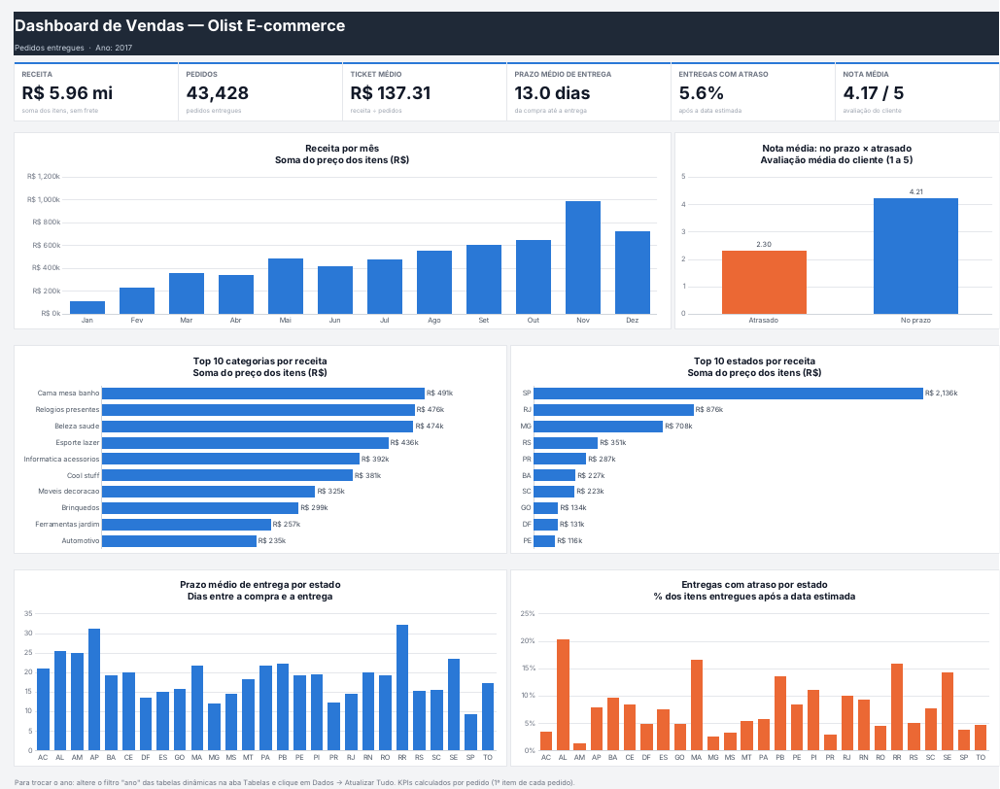

# Análise de vendas da Olist no Excel

Projeto de análise de dados feito no Excel com a base pública da Olist, um marketplace brasileiro. Usei Power Query para tratar e juntar as tabelas, tabelas dinâmicas para os cálculos e montei um dashboard em uma aba separada.

O recorte do dashboard é o ano de **2017** (pedidos entregues).

## O que eu queria responder

- Como a receita se comportou ao longo do ano?
- Quais categorias e estados vendem mais?
- Quanto tempo a entrega leva em cada estado e onde atrasa mais?
- Atraso na entrega muda a nota que o cliente dá?

## Dados

Base: [Brazilian E-Commerce Public Dataset by Olist](https://www.kaggle.com/datasets/olistbr/brazilian-ecommerce) (Kaggle).

Os CSVs originais não estão no repositório porque são pesados (o de geolocalização sozinho tem mais de 60 MB). Quem quiser refazer o tratamento pode baixar no link acima.

## Como fiz

1. Importei os CSVs no Power Query e juntei pedidos, itens, clientes, produtos e avaliações.
2. Criei algumas colunas:
   - `dias_até_a_entrega`: data de entrega menos data da compra
   - `Atrasado`: 1 quando a entrega passou da data estimada
   - `pedido_repetido`: 1 só no primeiro item de cada pedido, para contar pedidos sem duplicar
   - `ano` e `mês` da compra
3. O resultado ficou numa tabela com uma linha por item vendido (aba *Planilha Principal*).
4. Na aba *Tabelas* ficam as tabelas dinâmicas, filtradas por ano.
5. A aba *Dashboard* puxa os números das tabelas dinâmicas e da base.

## Resultados (2017)

| Indicador | Valor |
|---|---|
| Receita (só produtos, sem frete) | R$ 5,96 milhões |
| Pedidos entregues | 43.428 |
| Ticket médio | R$ 137,31 |
| Prazo médio de entrega | 13 dias |
| Pedidos entregues com atraso | 5,6% |
| Nota média | 4,17 |

O que deu pra tirar disso:

- A receita cresceu quase o ano todo, e novembro foi o melhor mês (perto de R$ 988 mil). Muito provavelmente por causa da Black Friday.
- SP sozinho fez R$ 2,1 milhões, cerca de 36% da receita. Somando RJ e MG chega a 62%.
- As categorias que mais faturaram foram cama, mesa e banho, relógios e presentes e beleza e saúde.
- Quem recebeu com atraso deu nota média 2,30. Quem recebeu no prazo deu 4,21. Foi a maior diferença que encontrei na base.
- Estados do Norte e Nordeste esperam bem mais. Em RR e AP a média passa de 30 dias, em SP fica perto de 9.

## Limitações

- A receita considera só o preço dos itens, sem frete.
- As tabelas dinâmicas calculam médias por item, então pedidos com vários itens pesam mais. Os cartões do dashboard calculam por pedido, por isso alguns valores diferem um pouco.

## Como abrir

Baixe o `planilha_principal.xlsx` e abra no Excel (2019 ou Microsoft 365). Para ver outro ano, troque o filtro "ano" das tabelas dinâmicas na aba *Tabelas* e use **Dados > Atualizar Tudo**.

---

Ryan Campos · [LinkedIn](https://linkedin.com/in/ryancamposs)
